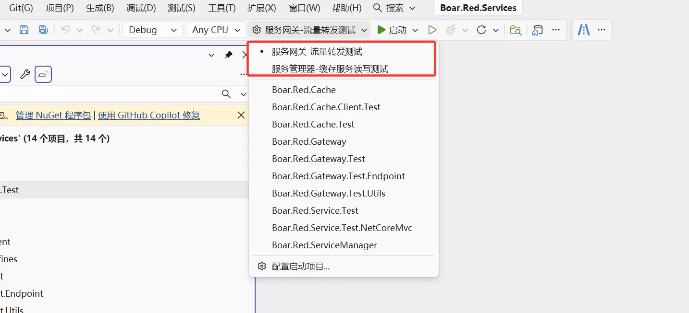
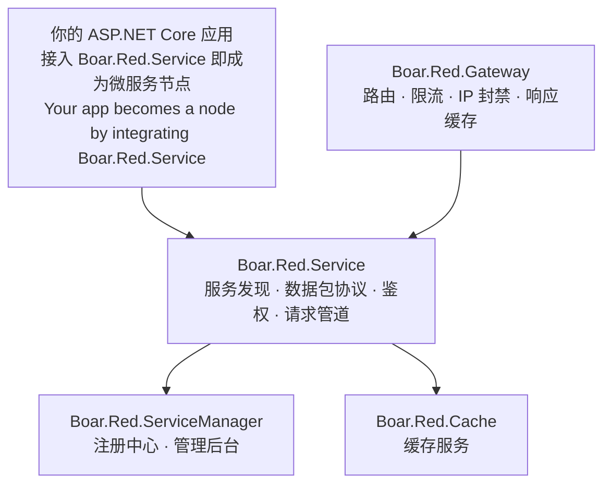

# Boar.Red.Services

[](https://dotnet.microsoft.com/)

Boar.Red 微服务框架的**聚合解决方案与运行体验入口**。本仓库提供 `Boar.Red.Services.slnx`、共享启动配置和使用文档，帮助你在一个 Visual Studio 窗口中打开整个框架，体验网关流量转发、服务注册和缓存读写。各组件源码位于独立仓库中。

The **aggregate solution and hands-on starting point** for the Boar.Red microservice framework. This repository provides the solution, shared launch profiles and guides for trying gateway forwarding, service registration and cache read/write in one Visual Studio window. Component source code lives in separate repositories.

---

## 快速体验 / Quick Start

第一次使用，按下面四步即可在 Visual Studio 中体验**网关流量转发**或**缓存读写**。仓库已提供共享启动方案，一次启动所需的服务与测试程序；管理页面使用随附的静态产物。

Follow these four steps to try gateway forwarding or cache read/write in Visual Studio. Shared launch profiles start the required services and test programs together, using the bundled management UI.

### 1. 准备环境 / Prerequisites

- **Windows + [Visual Studio 2026](https://visualstudio.microsoft.com/downloads/)**，安装时选择 **ASP.NET 和 Web 开发**工作负载。
- **[.NET 10 SDK](https://dotnet.microsoft.com/en-us/download/dotnet/10.0)**。可运行 `dotnet --list-sdks`，确认已安装 10.0.x SDK。
- **Git**，用于克隆下面的五个仓库；首次构建需要联网还原 NuGet 包。

For this illustrated walkthrough, use Windows, Visual Studio 2026 with the ASP.NET and web development workload, the .NET 10 SDK and Git.

### 2. 克隆全部仓库 / Clone All Repositories

在同一个工作目录的终端中执行下面全部命令：

Run all commands from the same parent directory:

```bash
git clone https://github.com/Boar-Red/Boar.Red.Service
git clone https://github.com/Boar-Red/Boar.Red.ServiceManager
git clone https://github.com/Boar-Red/Boar.Red.Gateway
git clone https://github.com/Boar-Red/Boar.Red.Cache
git clone https://github.com/Boar-Red/Boar.Red.Services
cd Boar.Red.Services
```

最终目录应如下所示。**五个文件夹必须位于同一级，名称保持不变**，解决方案才能找到所有项目：

Keep all five folders as **siblings with their original names** so the solution can resolve every project:

```text
工作目录/
├── Boar.Red.Service/         # 核心库 / core library
├── Boar.Red.ServiceManager/  # 服务管理器 / service manager
├── Boar.Red.Gateway/         # 网关与转发测试 / gateway and forwarding tests
├── Boar.Red.Cache/           # 缓存服务与读写测试 / cache and read/write tests
└── Boar.Red.Services/        # 聚合解决方案与共享启动配置 / solution and launch profiles
    ├── Boar.Red.Services.slnx
    └── Boar.Red.Services.slnLaunch
```

### 3. 选择方案并启动 / Select a Profile and Run

1. 用 Visual Studio 打开本仓库中的 **`Boar.Red.Services.slnx`**，等待 NuGet 还原完成。
2. 在顶部工具栏选择 **Debug** 和 **Any CPU**，按 **Ctrl+Shift+B** 生成解决方案。
3. 点击下图红框所示的启动配置下拉框，选择一个体验方案，再点击绿色 **启动** 按钮或按 **F5**。

Open `Boar.Red.Services.slnx`, wait for package restore, select **Debug / Any CPU** and build the solution. Choose one of the illustrated launch profiles, then press **F5**.



| 启动方案 / Launch Profile | 自动启动 / Started Together | 体验内容 / What to Try |
| --- | --- | --- |
| **服务网关-流量转发测试** | 测试端点、网关、网关测试程序 | 请求经过网关到达后端，查看流量转发与网关看板 |
| **服务管理器-缓存服务读写测试** | 服务管理器、缓存服务、缓存测试程序 | 查看缓存服务节点注册，体验缓存写入与读取 |

这两个方案保存在共享文件 [`Boar.Red.Services.slnLaunch`](Boar.Red.Services.slnLaunch) 中，Clone 后即可使用。以后编辑它们时，在“配置启动项目”中勾选 **共享配置 / Share Profile**。

首次运行时，可在“配置启动项目”中确认网关与测试端点的调试目标分别为 **Boar.Red.Gateway** 和 **Boar.Red.Gateway.Test.Endpoint**，与各自同名的项目启动配置一致。

Both profiles are included in the shared launch file. When editing them, enable **Share Profile** in Configure Startup Projects.

### 4. 查看运行效果 / Explore the Running Demo

**网关流量转发**

- 启动 **服务网关-流量转发测试** 后，测试程序会等待约 **10 秒**，再持续向网关发起并发请求。
- 打开 [网关管理页面](http://localhost/)，使用 **`admin` / `admin`** 登录，查看流量看板。
- 也可以在浏览器中打开 [一次网关转发请求](http://localhost/@stress_Test/stressWithConcurrentRequestTest/get?responseDurationSeconds=0)。看到“**响应正常**”表示请求已通过网关到达测试端点。
- 当前并发测试默认持续 **60 分钟**；体验完成后可随时按 **Shift+F5** 停止调试。

The gateway test waits about 10 seconds before generating concurrent requests. Open the gateway console at `http://localhost/` with `admin / admin`, or follow the sample forwarding link and look for “响应正常”. The default test runs for up to 60 minutes; stop debugging whenever you finish.

**缓存读写与服务管理**

- 启动 **服务管理器-缓存服务读写测试**，在缓存测试控制台中按提示查看读写测试进度与结果；默认一轮测试约 **60 秒**。
- 打开 [服务管理器页面](http://127.0.0.1:7001/)，使用 **`admin` / `admin`** 登录，查看缓存服务的注册节点与运行状态。
- 体验完成后按 **Shift+F5**。切换到另一个方案时，先停止当前调试，再选择新的方案启动。

For the cache demo, follow the cache test console and inspect its progress and results; the default test lasts about 60 seconds. Open the service manager at `http://127.0.0.1:7001/` with `admin / admin` to inspect the cache node. Stop the current session before starting another profile.

以上地址与账号对应仓库自带的本地示例配置，部署时请更换示例凭据。体验两个方案时，仅启动该方案列出的三个项目即可；其余项目可在继续开发或探索时单独运行。

These addresses and credentials come from the bundled local sample configuration. Replace sample credentials when deploying. Each profile starts the three projects needed for that demo.

### 常见启动问题 / Startup Help

| 遇到的情况 | 处理方式 |
| --- | --- |
| 项目显示未加载，或找不到项目引用 | 确认五个仓库都已克隆，位于同一级目录，名称与上面的目录树一致。 |
| 找不到 .NET SDK 或不支持 net10.0 | 安装 .NET 10 SDK，并使用支持 .NET 10 的 Visual Studio；重开解决方案后重新还原和生成。 |
| 下拉框中看不到两个体验方案 | 确认打开的是 `Boar.Red.Services.slnx`，并已包含同目录的 `.slnLaunch` 共享文件；在“配置启动项目”中检查方案。多项目启动功能的启用方式见 [Visual Studio 说明](https://learn.microsoft.com/en-us/visualstudio/ide/how-to-set-multiple-startup-projects?view=visualstudio)。 |
| 服务提示端口被占用 | 先停止上一次调试及重复启动的服务。网关方案使用 80、5009/7009 端口；缓存方案使用 7001、7002 端口。 |
| 首次启动提示 ASP.NET Core 开发证书 | 按 Visual Studio 的提示信任本机开发证书，再重新启动。 |

You can also verify the source build from the `Boar.Red.Services` directory:

```bash
dotnet build Boar.Red.Services.slnx
```

---

## 包含的项目 / Projects Included

| 项目 / Project | 所属仓库 / Repository | 说明 / Description |
| --- | --- | --- |
| `Boar.Red.Service` | [Boar.Red.Service](https://github.com/Boar-Red/Boar.Red.Service) | 框架核心库 / core library |
| `Boar.Red.Service.Test` | Boar.Red.Service | 核心库单元测试 / core library unit tests |
| `Boar.Red.Service.Test.NetCoreMvc` | Boar.Red.Service | 接入微服务能力的模板项目 / template app integrated with the framework |
| `Boar.Red.ServiceManager` | [Boar.Red.ServiceManager](https://github.com/Boar-Red/Boar.Red.ServiceManager) | 服务管理器 / service manager |
| `Boar.Red.Gateway` | [Boar.Red.Gateway](https://github.com/Boar-Red/Boar.Red.Gateway) | 网关服务 / gateway |
| `Boar.Red.Gateway.Defines` | Boar.Red.Gateway | 网关共享定义 / gateway shared definitions |
| `Boar.Red.Gateway.Client` | Boar.Red.Gateway | 网关客户端封装 / gateway client wrapper |
| `Boar.Red.Gateway.Test` / `.Test.Endpoint` / `.Test.Utils` | Boar.Red.Gateway | 网关测试 / gateway tests |
| `Boar.Red.Cache` | [Boar.Red.Cache](https://github.com/Boar-Red/Boar.Red.Cache) | 缓存服务 / cache service |
| `Boar.Red.Cache.Client` | Boar.Red.Cache | 缓存客户端（NuGet）/ cache client (NuGet) |
| `Boar.Red.Cache.Test` / `.Client.Test` | Boar.Red.Cache | 缓存测试 / cache tests |

## 框架总览 / Framework Overview



各服务的详细介绍与快速开始见对应仓库的 README：

See each repo's README for details and quick starts:

- [Boar.Red.Service](https://github.com/Boar-Red/Boar.Red.Service#readme) —— 核心库，非侵入式接入 / core library, non-intrusive integration
- [Boar.Red.ServiceManager](https://github.com/Boar-Red/Boar.Red.ServiceManager#readme) —— 服务管理器 / service manager
- [Boar.Red.Gateway](https://github.com/Boar-Red/Boar.Red.Gateway#readme) —— 网关 / gateway
- [Boar.Red.Cache](https://github.com/Boar-Red/Boar.Red.Cache#readme) —— 缓存 / cache

## 自动检查 / Automated Checks

每次提交和 Pull Request 的构建、测试、依赖审计及更新方式见 [CI 说明](docs/ci.md)。

See [CI and dependency updates](docs/ci.md) for automated build, test and dependency checks.

## 许可证 / License

各子项目的开源服务端代码与文档采用 MIT License，Copyright © 2026 Boar.Red。管理器与网关随附的管理 UI 暂时闭源，授权范围见各自仓库的 UI-LICENSE.md。

The open-source server code and documentation use the MIT License, Copyright © 2026 Boar.Red. The bundled management UI remains closed-source; see UI-LICENSE.md in the manager and gateway repositories.
